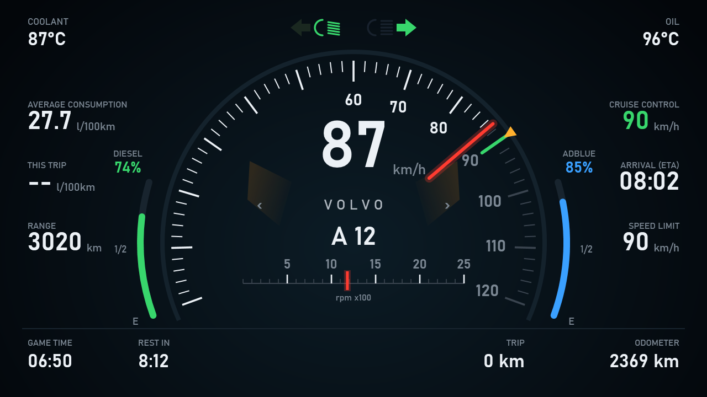

# ETS2 Instrument Cluster

A stand-alone digital instrument cluster for Euro Truck Simulator 2. It runs in its own window, so you can put it anywhere on your screens, away from the ETS2 GPS window.



It reads the live truck data from the **TruckSim GPS Telemetry Server** (default `127.0.0.1:31377`), the same source the [ETS2 GPS](https://github.com/johnevansau320/ETS2GPS-Win) apps use. It does not touch the game and sends nothing to it.

**User guide:** [ETS2-Instrument-Cluster-Guide.pdf](docs/ETS2-Instrument-Cluster-Guide.pdf) (installing, reading the cluster, the menu, using it with the GPS, troubleshooting).

## Install

Download from the [Releases](../../releases) page:

* **`Ets2ClusterSetup-<version>.exe`**: the setup program. Double-click it. It installs for your user only (no administrator rights), adds a Start Menu shortcut and the user guide, and can add a desktop shortcut and start the cluster when you log in.
* **`Ets2Cluster-portable-<version>.zip`**: unpack anywhere and run `Ets2Cluster.exe`. Nothing is installed.

Needs Windows 10 or 11 (64-bit). Nothing else to install: the program carries the .NET runtime it needs.

> **About security warnings.** The program is new and not signed with a paid code-signing certificate, so Windows SmartScreen or an antivirus may warn about it the first time. The checksums of the published files are on the release page (in PowerShell: `Get-FileHash .\Ets2ClusterSetup-1.0.0.exe`). If your security program flags the file you can report it to the vendor as a false positive. Please do not switch your antivirus off.

## What it shows

* **Speedometer** with a needle that glides between updates, the speed in big digits, tick marks that light up to the current speed, a green mark for the **cruise-control setting** and an amber marker for the **speed limit**. Over the limit the digits and the glow beside the dial turn amber.
* **Gear** (A 12 for an automatic in 12th, N, R) and a **rev strip** with the rpm marker (amber near the limiter).
* **Diesel** (green) and **AdBlue** (blue) gauges either side of the dial, with the percentage.
* **Average consumption** (the game's figure), **this trip** (measured since the trip was reset), **range**, **cruise setting**, **arrival time (ETA)** and **speed limit**.
* **Coolant** and **oil** temperature, **game time**, **time until you must rest**, **trip** distance and **odometer**.
* Lamps: both turn signals, low and high beam; tags for the parking brake, engine brake, retarder step, wipers, beacon and the warnings (air pressure, oil pressure, coolant, battery, low fuel, low AdBlue).
* The truck make under the speed (VOLVO, SCANIA ...), which can be switched off.

## Using it

| Action | How |
|---|---|
| Move | Drag anywhere on the cluster |
| Resize | Drag the grip in the bottom right corner, or turn the mouse wheel over the cluster. The 16:9 shape is kept |
| Opacity | Ctrl + mouse wheel, or right-click > Opacity |
| Full screen | Double-click, or **F11** (Esc to leave) |
| Always on top | Right-click > Always on top (on by default). The game must be windowed or borderless for another window to show above it |
| Menu | Right-click: always on top, opacity, size presets, units (km/h or mph), show the make, reset trip, telemetry server address, reset window, update checks, close |

The position, size, opacity and options are remembered in `%APPDATA%\ETS2-Cluster\cluster.json`. The trip counter starts the first time the cluster sees the truck; **Reset trip** restarts the trip distance and the trip consumption. Refuelling is ignored when working out the trip consumption.

## Updates

The cluster looks for a newer release on GitHub a few seconds after it starts and then about once a day. When there is one, a small notice appears at the bottom of the cluster; right-click it to open the download page, or to **Skip this version**. **Check for updates now...** looks immediately, and **Check for updates automatically** (on by default) switches the checks off.

Nothing is downloaded or installed for you. The check is one small request to pi.github.com, which sees your IP address like any web page does; the cluster sends no information about you or your PC, and it only ever opens a page on github.com. Offline, it does nothing.

## Building

Needs the .NET 8 SDK (and [Inno Setup 6](https://jrsoftware.org/isinfo.php) for the setup program).

```
build.ps1              self-contained app in publish\ (plain files, no self-extracting exe)
build-installer.ps1    the setup program: installer\Output\Ets2ClusterSetup-<version>.exe  (-SkipBuild reuses publish\)
build-portable.ps1     the portable zip: installer\Output\Ets2Cluster-portable-<version>.zip
install.ps1            installs without the setup program (Start Menu shortcut; -NoPrompt, -Autostart)
```

Command line (testing): `--config file.json`, `--host 127.0.0.1:31377`, `--demo` (made-up values, no game needed; `--demo-state over|warn` for other states), `--snapshot out.png` (draws the cluster to a picture and quits).

## Notes

* The telemetry server reports the speed and the cruise-control setting in the same unit, which the cluster treats as km/h.
* The outside temperature is not in the telemetry, so the corners show coolant and oil temperature instead.
* "Average consumption" is the game's figure; "this trip" is measured by the cluster, so it starts empty (`--`) until you have driven a short way.
* The cluster is drawn on a fixed 1280 x 720 canvas and scaled to the window, so it looks the same at any size.

## License

GNU Affero General Public License v3.0, see [LICENSE](LICENSE). ETS2 / Euro Truck Simulator 2 is a trademark of SCS Software; this project is not affiliated with or endorsed by SCS Software. No game data is included.
